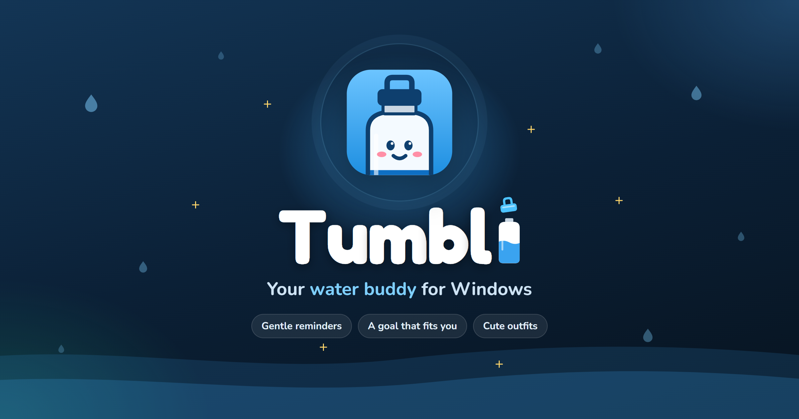
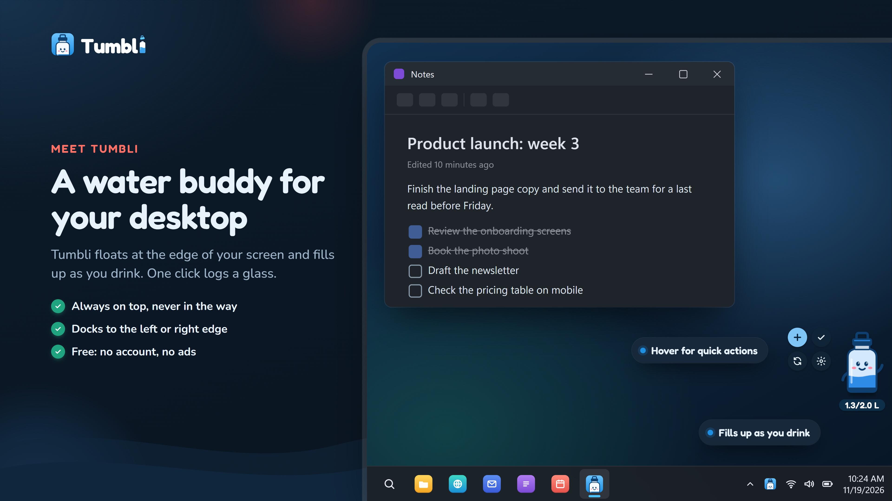
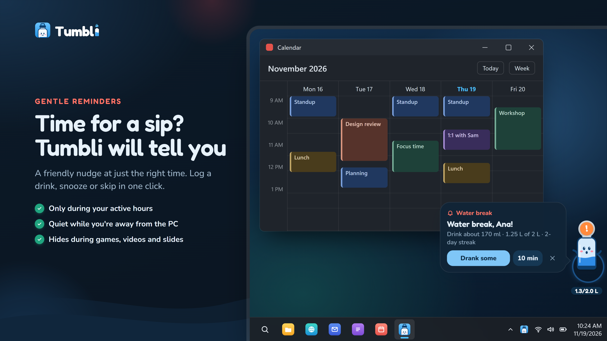
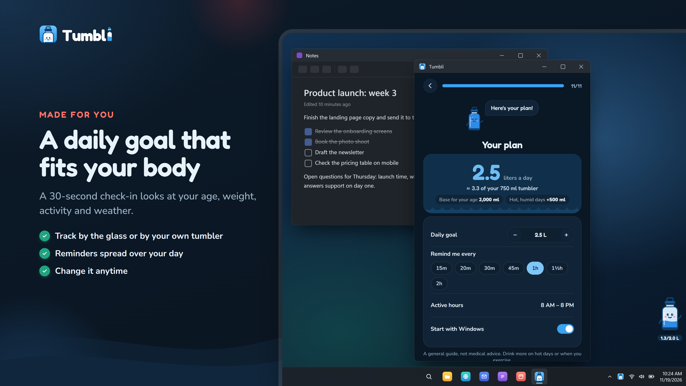
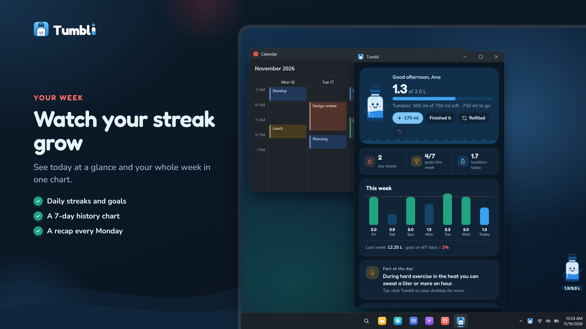
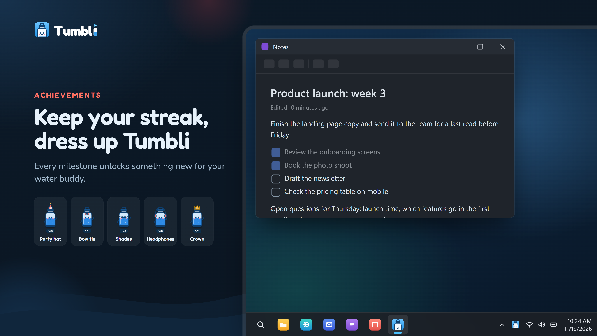
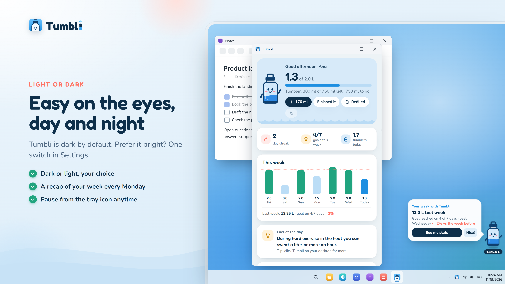

<p align="center">
  
</p>

<p align="center">
  <b>A water buddy for your desktop.</b><br>
  A little sport bottle with a face that floats at the edge of your Windows screen,<br>
  fills up as you drink, and reminds you to take a water break.
</p>

<p align="center">
  <a href="https://apps.microsoft.com/detail/9N6798TPR3KX">Microsoft Store</a> ·
  <a href="https://adrianniel.github.io/Tumbli/privacy.html">Privacy</a> ·
  <a href="mailto:adrianniel.garig@gmail.com">Feedback</a>
</p>



## What it does

### Gentle reminders, at the right time

Every so often Tumbli hops, waves and pops up a friendly reminder. Log a drink, snooze or skip in one click,
or press **Ctrl+Alt+W** from any app. It only reminds you during your active hours, stays quiet while you're
away from the keyboard, and hides during fullscreen games, videos and presentations.



### A daily goal that fits you

A 30-second check-in looks at your age, weight, activity and weather and suggests a goal. Track by the glass,
or by your own tumbler or bottle: Tumbli mirrors it, so when yours is empty, Tumbli is too.



### Your week at a glance

Daily streaks, today's progress, a 7-day chart, and a recap of last week every Monday.



### Achievements and outfits

Milestones unlock outfits for Tumbli: a party hat, a bow tie, sunglasses, headphones and a crown.
Click Tumbli anytime for a water fact or a bit of trivia.



### Dark or light

Dark mode by default, light mode with one switch in Settings.



### And also

- Docks to the left or right edge of the screen; drag it anywhere and it snaps back
- Pause reminders for an hour or until tomorrow from the tray icon
- Starts with Windows (optional)
- No account, no ads, no tracking: everything stays on your PC

Tumbli stays on screen until you choose **Quit Tumbli** from its tray icon. Its daily goal is a general guide,
not medical advice.

## Tech

[Tauri 2](https://tauri.app) (Rust) + React 19 + TypeScript + Vite. Two windows: the transparent, always-on-top
widget and the settings window.

| Path | What |
|---|---|
| `src/widget/` | The floating widget: `Widget.tsx` wires up docking, reminders, gestures, the shortcut and the speech bubbles |
| `src/settings/` | Settings and stats, the first-run hydration check, wardrobe and feedback |
| `src/components/` | Tumbli himself (`Tumbler.tsx`), shared controls and icons |
| `src/lib/` | Storage, the hydration plan, scheduling, achievements, the weekly recap, docking math, theme (each with tests) |
| `src-tauri/src/lib.rs` | Tray menu, idle and fullscreen detection, startup task, window bounds and region |

The widget window keeps one size and each mode (idle, hover, speech bubble) only changes its window region, so
Tumbli never jumps while the window grows or shrinks, and clicks outside the visible part go to the apps behind it.

## Development

Prerequisites: [Node.js](https://nodejs.org), [Rust](https://rustup.rs), and the Visual Studio C++ Build Tools
(see [Tauri prerequisites](https://tauri.app/start/prerequisites/)).

```bash
npm install
npm run tauri dev     # run with hot reload (the first reminder pops up after 15 s)
npm test              # unit tests (Vitest)
npm run dev           # just the UI in a browser, with the Tauri backend mocked (src/dev/mocks.ts)
npm run screenshots   # regenerate the Store screenshots from the real UI (needs `npm run dev`)
```

With `npm run dev` you can preview any state in a browser, for example
`http://localhost:1420/widget.html?demo&nudge` or `http://localhost:1420/settings.html?demo&theme=light`
(see `src/dev/mocks.ts` and the dev block in `src/widget/Widget.tsx` for all options).

## Microsoft Store (MSIX)

The Store build is an MSIX package made from the release exe. The package identity from Partner Center is
already in `packaging/msix/identity.json`.

```bash
npm run tauri build -- --no-bundle
powershell -ExecutionPolicy Bypass -File scripts/package-msix.ps1
```

Then upload `dist-msix/Tumbli_<version>_x64.msix` in the submission's **Packages** step; the Store signs it.
Bump `version` in `src-tauri/tauri.conf.json` (and `package.json`) for every new submission.

The manifest declares `runFullTrust` (all desktop apps need it) and a `windows.startupTask` so "Start with
Windows" works inside the package.

Store copy (description, features, search terms, certification notes) is in [STORE_LISTING.md](STORE_LISTING.md),
screenshots in `store-assets/screenshots/`, and the privacy policy in [docs/privacy.html](docs/privacy.html).
